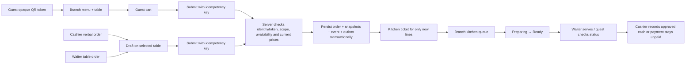
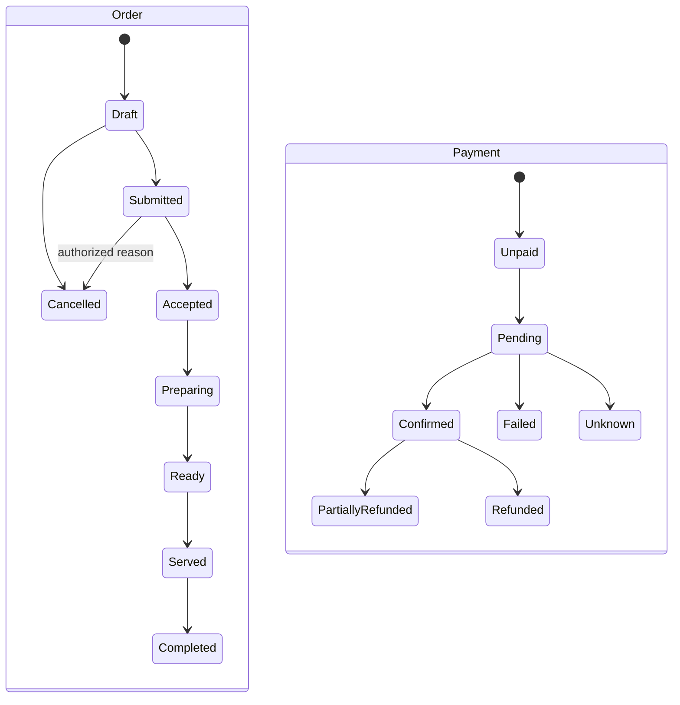

# P4.0 restaurant operations UX and domain specification

Status: implementation contract for P4.1 onward.  
Baseline: P3.3 `80257b46ebec29c9501473c2e8aac86ce0549838` (P3 PR #4 is still unmerged).  
Preview contract: all public role demos use synthetic data and visibly say `DEMO`; no Preview action creates a real order or payment.

## Role and permission matrix

| Surface / role   | Read                                                                                                       | Write                                                                                                       | Explicitly denied                                                                             |
| ---------------- | ---------------------------------------------------------------------------------------------------------- | ----------------------------------------------------------------------------------------------------------- | --------------------------------------------------------------------------------------------- |
| Owner            | All branches, catalog, tables, orders, shifts, transactions, staff and branch reports in own organization. | Manage branches, catalog, prices, tables, staff grants, shifts, orders and approved synthetic cash records. | Other organizations; real online charges or fiscal actions.                                   |
| Director         | Organization branches and operational summaries.                                                           | Manage catalog, branch tables and branch-scoped staff/operations; cannot grant owner/director.              | Other organizations; online charges or privileged platform access.                            |
| Administrator    | Assigned branch catalog, tables, operations and staff roster.                                              | Manage assigned branch tables/catalog and operational records.                                              | Other branches unless separately assigned; organization ownership.                            |
| Accountant       | Assigned branch orders, shifts, transaction history and reports.                                           | Reconcile/report actions only when specifically authorized.                                                 | Catalog/order mutation and cash confirmation by default.                                      |
| Cashier          | Assigned branch availability, tables, submitted orders, shift and transaction history.                     | Create/edit a draft; submit once; record authorized cash payment; open/close own shift.                     | Other branches, catalog price mutation, unverified payment confirmation/refund.               |
| Waiter           | Assigned branch tables and active orders.                                                                  | Create/add order lines, notes, send new lines, mark served/request bill.                                    | Payment confirmation, finance settings and other branches.                                    |
| Kitchen          | Assigned branch ticket queue, items, notes and preparation history.                                        | Accept, start preparation, mark ready.                                                                      | Guest identity, cash/payment data, finance and unrelated branches.                            |
| Guest            | Menu resolved through an active opaque table token; own order/status only.                                 | Create an order, append guest changes while allowed, choose pay-at-cashier.                                 | Organization directory, other guests/orders, staff controls or payment assertion.             |
| Platform support | None by default.                                                                                           | No P4 support-write surface.                                                                                | Cross-tenant browsing and impersonation; no Super Admin endpoint is introduced by this scope. |

The API and RLS remain authoritative. Branch-scoped roles require current membership on every request. A UI role selector is only a synthetic-preview control, never an authentication mechanism.

## Operational journeys

### Owner workspace

1. Sign in and complete MFA where the P2 policy requires it.
2. Select an organization and branch; display the active scope in the header.
3. Review orders, table states, shifts and branch report with source/time range shown.
4. Manage categories, products, availability, price versions, tables and revocable QR token.
5. Manage staff access using existing role rules; show permission and audit outcome.
6. Empty, loading, unavailable and forbidden states explain the next safe action.

### Cashier verbal order to kitchen

1. Select assigned branch, open shift and a free table or walk-in/takeaway.
2. Search/filter a visual catalog; only server-confirmed available products and current prices can be submitted in integrated mode.
3. Choose a product, adjust quantity with `−`, numeric entry, `+`; show line and order totals in minor units.
4. Add order note; submit using an idempotency key. Disable/relabel the button while awaiting result.
5. On success show canonical order ID and kitchen status; on timeout show `status unknown` and allow safe status lookup/retry with the same key.
6. Payment remains unpaid until an authorized cashier records cash or an approved payment provider confirms it server-side.

### Waiter adds items to an existing table

1. Open an assigned occupied table and inspect its canonical open order.
2. Add products to a new draft ticket; preserve existing submitted lines and snapshots.
3. Send only the new lines as a separate, idempotent kitchen ticket.
4. Show the per-ticket kitchen state and updated bill; prevent resending a completed request as a new ticket.

### Kitchen queue

1. Display branch-scoped oldest-first tickets with order/table, items, quantities and preparation notes.
2. Worker accepts, starts preparation, marks ready; state transitions are explicit and audited.
3. Duplicate events are ignored; disconnected state is visible. If push is unavailable, bounded polling is labeled as polling.
4. Kitchen UI never renders payment details or owner finance metrics.

### Guest QR/NFC to cashier

1. Resolve an unguessable, revocable token to one active branch/table; token is never an organization admin credential.
2. Show menu, availability, price/currency and demo/staging state. Do not trust table/branch IDs sent by the browser.
3. Guest reviews quantities and submits an order with idempotency; can view only that order's public status token.
4. `Pay at cashier` leaves payment `unpaid`. Online payment is visibly disabled; there is no checkout request or fake success.

### Cashier cash record and transaction history

1. Cashier opens an unpaid completed/served order and views immutable line/price snapshots.
2. With the active branch role and shift, record a synthetic cash payment atomically; repeated submission returns the existing result.
3. Payment event and audit record are append-only. Corrections are a distinct authorized compensating action, not an edit/delete.
4. History shows order, branch/table, cashier, line items, currency/minor-unit total, method, status, reference and void/refund state. Demo records are labeled.

### Tenant isolation and stale-data handling

- Every order, table, catalog item, ticket, shift and payment has `organization_id`; branch-bound rows carry `branch_id` with composite scope constraints.
- Organization/branch scope comes from verified membership and route resource ownership, never from body claims.
- A price change creates a new version; existing order snapshots remain immutable. A stale product price version is rejected with a refreshable conflict response.
- Cross-tenant IDs return a generic denial/not-found response and are covered by negative database/API tests.
- Duplicate order, ticket and payment requests use stable idempotency keys scoped by tenant/action and request hash; reuse with different data is rejected.

## Workflow diagrams

### Cashier, waiter, kitchen and guest order entry

### Order and payment are independent state machines

The diagrams describe target behavior; the P3.3 application does not yet implement these server workflows. UI-only Preview behavior must be labeled synthetic and must not report these diagrams as integrated functionality.

## State models

### Order (separate from payment)

`draft → submitted → accepted → preparing → ready → served → completed`

`draft → cancelled`; an authorized manager may cancel a submitted order before completion with a required reason and history event. Completed orders are never deleted. State changes must come from an allowed actor and prior state; no client-supplied arbitrary status is accepted.

### Kitchen ticket

`queued → accepted → preparing → ready → served`

One ticket captures only newly submitted line snapshots. Additional waiter/cashier items create another ticket. A ticket cannot transition twice from a stale version.

### Payment

`unpaid → pending → confirmed | failed | unknown`

`confirmed → partially_refunded | refunded` only via a distinct authorized operation. Cash confirmation is a server-side cashier action. Terminal-card and online provider flows remain disabled/sandbox-only until approved integration and verified callbacks exist. Order completion and payment confirmation are separate dimensions.

## UX states, accessibility and localization

- Every surface defines loading, empty, unavailable/offline, unauthorized, conflict/stale, success and safe retry states.
- Cashier primary controls target at least 44×44 CSS px; cart quantity has separate decrement, numeric input and increment controls with accessible names.
- Keyboard navigation and visible focus are required; kitchen status uses text and icon, not color alone.
- Reduced motion removes nonessential movement; POS avoids parallax and decorative entrance motion.
- Operational labels, validation and error states are localized UZ/RU/EN. Money displays currency code and avoids floating-point arithmetic.
- A persistent banner says `Synthetic demo — actions are not saved or sent` whenever the Preview is not backed by an approved API.

## P4.0 acceptance checklist

- [ ] Role/permission matrix reviewed against existing P2 role and MFA policy.
- [ ] Cashier-to-kitchen, waiter-addition, guest-to-cashier, authorized cash and owner-report journeys have UI/API acceptance cases.
- [ ] Order, ticket and payment state transitions are server-enforced and independently tested.
- [ ] Synthetic Preview behavior is distinct from local database/API integration tests.
- [ ] Provider, fiscal, tax and merchant policies remain disabled until separately approved.

## Decisions intentionally deferred

- Tax/service-charge rules, refund approval thresholds, fiscal receipt obligations, shift reconciliation rules, menu media storage, offline operation and legal retention require jurisdiction/pilot validation. The interface must not invent these as live business rules.
- Default display currency may be UZS for the Uzbekistan-first demo, but currency is stored per catalog/order and no tax calculation is implied.
- No shared hosted Preview API/database or paid infrastructure is assumed. If integrated staging is later required, propose a separate cost, data-location and operations decision before provisioning.
