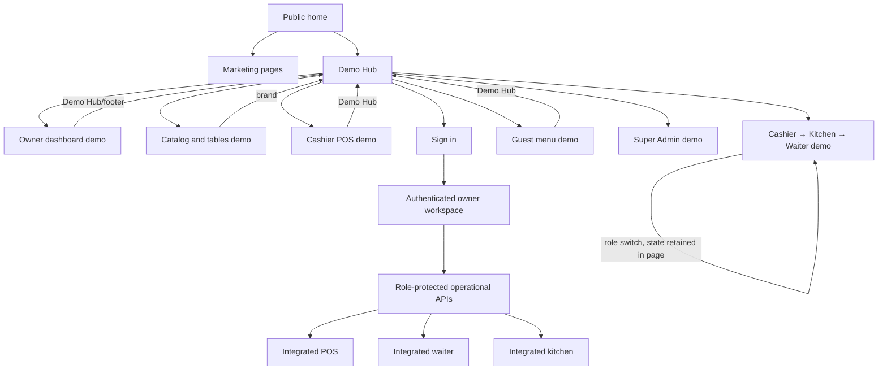

# P4.3.1 Navigation Audit

## Scope and verified baseline

This audit covers the Next.js App Router routes present in `apps/website/app` on the P4 feature branch. `/api/[...path]` is an API route, and `/icon.svg` is a static asset rather than a page. The operational routes remain API-authorized; a visible link or route response is not an authorization grant. The Vercel Preview is frontend-only and the demo routes use synthetic data.

## Route inventory

| Route                | Purpose                                       | Audience                         | Auth         | Entry point                    | Return path                             | Status                                                      |
| -------------------- | --------------------------------------------- | -------------------------------- | ------------ | ------------------------------ | --------------------------------------- | ----------------------------------------------------------- |
| `/`                  | Marketing home                                | Public, owners, investors        | No           | Logo, direct visit             | Public header/footer                    | Implemented; Modern Luxury                                  |
| `/solutions`         | Product solutions                             | Public, owners                   | No           | Public navigation              | Header/footer                           | Implemented                                                 |
| `/pricing`           | Pricing preview                               | Public, owners                   | No           | Public navigation              | Header/footer                           | Implemented; no billing                                     |
| `/about`             | Company information                           | Public                           | No           | Public navigation              | Header/footer                           | Implemented                                                 |
| `/contact`           | Contact/demo state                            | Public                           | No           | Public navigation              | Header/footer                           | Implemented; no message delivery                            |
| `/security`          | Security explanation                          | Public                           | No           | Public navigation              | Header/footer                           | Implemented; preview limits disclosed                       |
| `/faq`               | Product FAQ                                   | Public                           | No           | Public navigation              | Header/footer                           | Implemented                                                 |
| `/investors`         | Investor information                          | Public, investors                | No           | Public navigation              | Header/footer                           | Implemented; informational                                  |
| `/sign-in`           | Authentication entry                          | Members                          | Yes          | Public header                  | Home/dashboard                          | Implemented; backend may be unavailable in Preview          |
| `/sign-up`           | Account registration                          | New members                      | Yes          | Sign-in flow                   | Sign-in                                 | Implemented; backend may be unavailable in Preview          |
| `/dashboard`         | Organization and branch management            | Owner/director                   | Yes          | Authenticated redirect         | Public home/sign-out                    | Implemented; server authorization applies                   |
| `/dashboard/pos`     | Integrated cashier POS                        | Cashier and authorized managers  | Yes          | Direct or authorized workspace | `/dashboard`, pending-order resolution  | Implemented; requires API                                   |
| `/dashboard/waiter`  | Integrated waiter workspace                   | Waiter and authorized managers   | Yes          | Direct or authorized workspace | `/dashboard`, pending-addition recovery | Implemented; requires API                                   |
| `/dashboard/kitchen` | Integrated KDS                                | Kitchen and authorized managers  | Yes          | Direct or authorized workspace | `/dashboard`                            | Implemented; requires API                                   |
| `/demo`              | Central demo directory                        | Public                           | No           | Marketing navigation/footer    | Marketing home                          | Implemented; now lists six demos                            |
| `/demo/dashboard`    | Synthetic owner dashboard                     | Public demo visitor              | No           | Demo Hub                       | Demo Hub / public navigation            | Implemented; synthetic metrics                              |
| `/demo/workspace`    | Legacy alias for dashboard demo               | Public demo visitor              | No           | Guest menu                     | Demo Hub / public navigation            | Implemented; duplicates `/demo/dashboard`                   |
| `/demo/super-admin`  | Synthetic platform admin UI                   | Public demo visitor              | No           | Demo Hub                       | Demo Hub / public navigation            | Implemented; no admin API                                   |
| `/demo/operations`   | Catalog, branch pricing and tables demo       | Public demo visitor              | No           | Demo Hub, POS banner           | Demo Hub via brand                      | Implemented; local synthetic state                          |
| `/demo/pos`          | Cashier order-entry demo                      | Public demo visitor              | No           | Demo Hub                       | Demo Hub link/header and service demo   | Implemented; synthetic order only                           |
| `/demo/service`      | Same-page cashier → kitchen → waiter workflow | Public demo visitor              | No           | Demo Hub, POS                  | Demo Hub via brand                      | Implemented; shared state only in this page instance        |
| `/demo/guest`        | Guest QR menu and demo cart                   | Public demo visitor              | No           | Demo Hub                       | Demo Hub in header                      | Implemented; no order submission                            |
| `/api/[...path]`     | Application API dispatch                      | Authenticated/authorized clients | Per endpoint | Application clients            | N/A                                     | Implemented; role, tenant and branch checks are server-side |

## Findings and changes

- The Demo Hub listed four of the existing demo paths. Cashier POS and the combined service journey were not discoverable there.
- Guest menu returned to a dashboard demo, which was not a clear return to the demo directory. It now has a localized direct Demo Hub link and the logo returns there.
- Cashier demo exposed catalog and service links but lacked a direct Demo Hub return. A visible link was added.
- The public mobile navigation could be toggled but did not move focus into the menu or support Escape-to-close with focus restoration. Both behaviors are now implemented, and its toggle labels are localized in UZ/RU/EN.
- Public desktop and mobile menus now expose `aria-current="page"` and a visible active destination style.
- The organization dashboard previously displayed cashier, waiter and kitchen links whenever auth was configured. That condition did not prove the current user's role. Those links were removed; the page now links to the public Demo Hub. Operational API authorization remains authoritative.
- The owner dashboard and integrated staff workspaces do not yet have a shared role-aware shell or verified cross-role navigation. The Preview has no auth backend, so role visibility cannot be honestly tested there. The authenticated APIs remain the security boundary.
- `/demo/workspace` and `/demo/dashboard` render the same page and are duplicate routes. Kept for compatibility; Demo Hub points to `/demo/dashboard`.
- The service workflow deliberately keeps role switching on one page so in-memory synthetic order/ticket state is not lost during route changes.

## Information architecture

## UX, localization and safety notes

- Public marketing navigation has desktop and expandable mobile navigation. Demo Hub additions use the existing UZ/RU/EN content map.
- The guest menu's Demo Hub label is localized in UZ/RU/EN. Operational demo interfaces are currently primarily Uzbek; they do not claim full three-language parity.
- Demo and integrated workspaces remain separate. Synthetic changes do not write to a database.
- The authenticated POS retains its existing pending-order idempotency key and original payload in session storage. P4.3.1 does not modify that flow.
- Organization/branch selection remains explicit within authenticated workflows. No global switcher was added because there is no shared verified role/context API for safely synchronizing scope across pages.
- No new production capability, payment, shift, or financial feature is exposed.

## Remaining limitations / P4.4 readiness

1. Build a shared operational shell only after the server can return verified per-organization/per-branch capabilities suitable for navigation. Frontend role choice must never confer access.
2. Consolidate the duplicate `/demo/workspace` alias when compatibility and inbound links are known.
3. Decide whether integrated routes need localized navigation labels; currently those screens are English or Uzbek depending on the workspace.
4. P4.4 is not started. Before it begins, finish role-aware navigation and verify the pending-order retry and cash-shift authorization contracts against the integrated API. No payment or shift action is implied by the current links.
